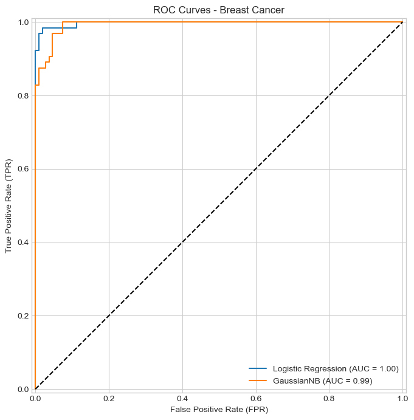
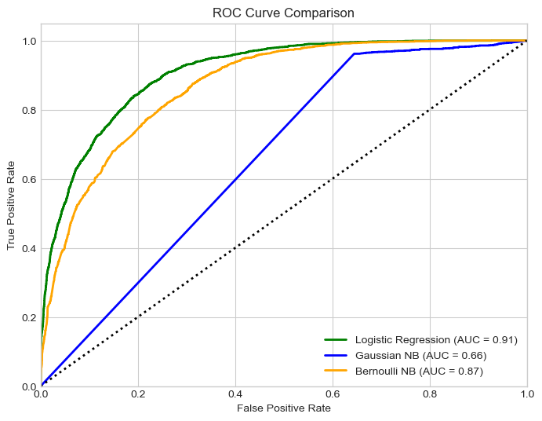
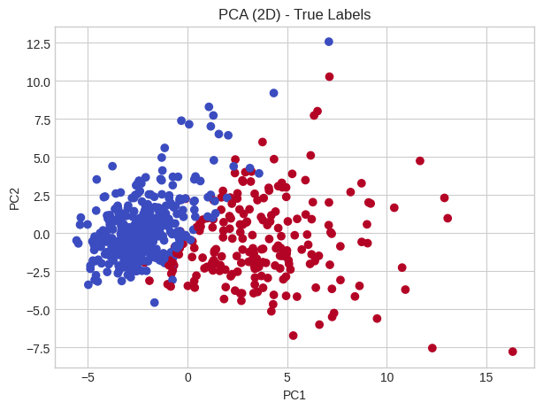
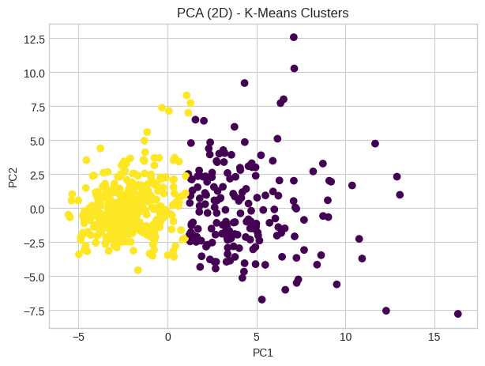
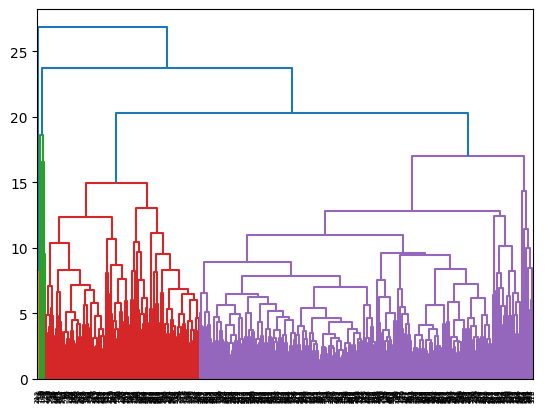

# Supervised vs Unsupervised Learning: A Side-by-Side Study

This project compares **supervised classifiers** with **unsupervised clustering** on the same two datasets. It shows how the type of data and the preprocessing choices change which model works best.

| Dataset | Size | Features | Target |
|---|---|---|---|
| [Breast Cancer Wisconsin](https://archive.ics.uci.edu/dataset/17/breast+cancer+wisconsin+diagnostic) | 569 | 30, all continuous | Benign / Malignant |
| [Adult Income](https://archive.ics.uci.edu/dataset/2/adult) | 48,842 | 14, mixed numeric and categorical, with missing values | Income ≤50K / >50K |

## Part 1: Logistic Regression vs Naive Bayes

| Dataset | Model | Accuracy | ROC-AUC |
|---|---|---|---|
| Breast Cancer | **Logistic Regression** | **97.1%** | **0.998** |
| Breast Cancer | Gaussian NB | 93.6% | 0.993 |
| Adult Income | **Logistic Regression** | **85.5%** | **0.91** |
| Adult Income | Bernoulli NB | 76.5% | 0.87 |
| Adult Income | Gaussian NB | 37.3% | 0.66 |

  
  

**Takeaways:**

- **Gaussian NB fails on Adult Income.** One-hot encoded categorical data breaks its assumptions of independent, normally distributed features. Switching to **Bernoulli NB**, which suits binary features, more than doubled its accuracy.
- **Logistic Regression won on both datasets.** It handles mixed feature types well once they are standardized.

## Part 2: SVM vs K-Means & Hierarchical Clustering

| Dataset | Model | Result |
|---|---|---|
| Breast Cancer | Linear SVM | 96.5% accuracy, ROC-AUC 0.994 |
| Breast Cancer | RBF SVM (C=5, γ=0.01) | 95.9% accuracy, ROC-AUC 0.997 |
| Breast Cancer | K-Means | Silhouette 0.34 |
| Adult Income | Linear SVM | 84.6% accuracy, ROC-AUC 0.90 |
| Adult Income | RBF SVM | 85.2% accuracy, ROC-AUC 0.90 |
| Adult Income | K-Means / Hierarchical | Silhouette 0.06 / 0.93* |

\* *The high hierarchical score is misleading: almost every sample was placed in one cluster.*

  
  

**Takeaways:**

- **Kernel choice:**
  - Breast Cancer is almost linearly separable, so the linear SVM was barely affected by `C`.
  - The RBF kernel helped a little on the more complex Adult data.
- **Clustering vs labels:** K-Means found the rough benign/malignant split, but clustering can't match supervised accuracy when the classes overlap.
- **Don't trust one metric:** A silhouette score can look excellent even when the clustering is useless. That's why the clusters were also compared with the true labels and plotted in 2-D with PCA.

## Good practices applied

- The train/test split is done **before** scaling, so the scaler never sees test data (no data leakage).
- Hidden missing values (`?`) in the Adult dataset were detected and handled.
- One-hot encoding for unordered categories, label encoding for the target.
- Hyperparameter tuning for SVM (`C`, `γ`).
- Evaluation with accuracy, precision, recall, F1, ROC-AUC, confusion matrices and silhouette score.

## Tech stack

Python · scikit-learn · pandas · NumPy · SciPy · Matplotlib · Seaborn
